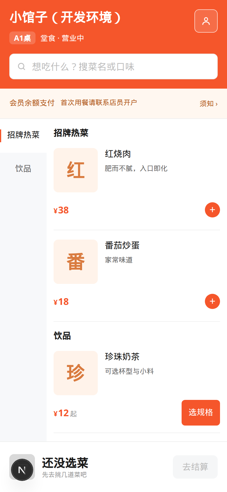
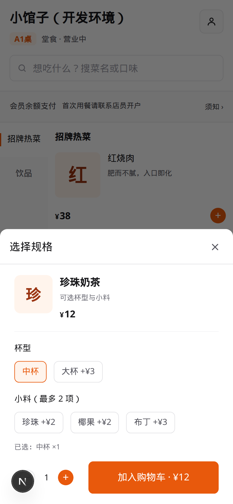
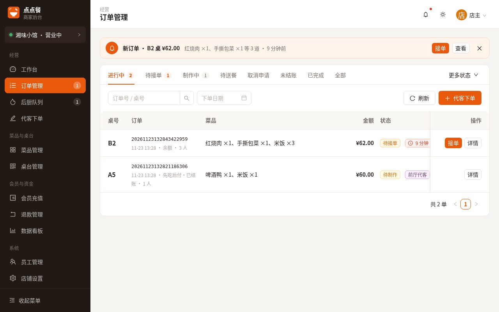
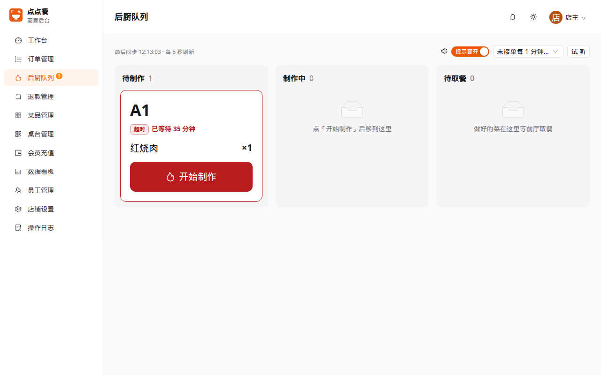

# 点点餐

给小餐馆用的堂食扫码点餐：顾客扫桌码，用会员余额下单；店员在后台接单、出餐、退款。

<table>
  <tr>
    <td width="400" valign="top">
      
      <br />扫桌码点餐：菜单、桌号、余额支付
    </td>
    <td width="400" valign="top">
      
      <br />规格加购：杯型、小料、实时计价
    </td>
  </tr>
  <tr>
    <td width="400" valign="top">
      
      <br />订单列表：状态、退款、按桌号检索
    </td>
    <td width="400" valign="top">
      
      <br />后厨队列：待制作，超时订单标红
    </td>
  </tr>
</table>

## 功能

- 扫桌码进入 H5 菜单，选规格后用会员余额支付。没有微信或支付宝在线收款。
- 商家接单、后厨制作、送达；超时未接单会自动取消并退款。
- 退款退回会员余额，店主审核。
- 菜品、桌台二维码、会员充值、员工账号。
- 店主、前厅、后厨看到的菜单和接口不同。

## 技术栈

| | |
| --- | --- |
| 后端 | Spring Boot 3.3、MyBatis-Plus、PostgreSQL 16、Flyway |
| 顾客端 | Next.js，静态导出在 `/h5/` |
| 商家端 | Vite、React 18、Ant Design 5 |

## 实现上值得看的地方

- 顾客和员工是两套 JWT。店主、前厅、后厨的接口按角色分开。
- 金额以「分」保存。下单和退款按请求号幂等，重复提交不会多扣。
- 后厨和订单列表轮询同步。断线有提示，恢复后继续。
- 后端集成测试用 Testcontainers 起 PostgreSQL。顾客端用 Playwright 覆盖结算。

## 本地运行

需要 JDK 17+、Maven、Node.js 20+、Docker。在仓库根目录执行以下命令，后三条分别在独立终端运行。

```bash
docker compose -f deploy/docker-compose.dev.yml up -d
(cd server && mvn spring-boot:run -Dspring-boot.run.profiles=dev)
(cd merchant-web && npm install && npm run dev)
(cd customer-web && npm install && npm run dev)
```

| | |
| --- | --- |
| 后端 | http://localhost:8080 |
| 商家后台 | http://localhost:5173 ，`admin` / `admin123` |
| 顾客 H5 | http://127.0.0.1:3000/h5/?token=dev-table-a1 |
| 会员 | `13800000001` / `staff123`，余额 100 元 |

后端默认端口是 `server.port`（8080）。前端把 `/api` 代理到 `API_PROXY_TARGET`。换端口时两个前端一起改。Docker 29 跑测试要加 `-DargLine="-Dapi.version=1.44"`，否则集成测试会被跳过。

## 目录

```
server/         后端
merchant-web/   商家后台
customer-web/   顾客 H5
deploy/         Docker 部署
docs/           架构与规范
```

架构说明见 [docs/项目架构.md](docs/项目架构.md)，部署见 [deploy/README.md](deploy/README.md)。

本仓库是个人项目，用于学习。
